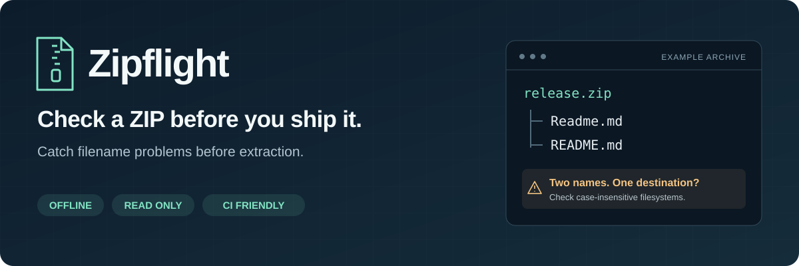

<p align="center">
  
</p>

<p align="center">
  <a href="https://github.com/zare5/zipflight/actions/workflows/ci.yml"></a>
  <a href="https://github.com/zare5/zipflight/releases"></a>
  
  <a href="LICENSE"></a>
</p>

<p align="center"><a href="README.zh-CN.md">简体中文</a> · <a href="#try-it">Try it</a> · <a href="#what-it-finds">Checks</a> · <a href="docs/alternatives.md">Alternatives</a></p>

# Zipflight — check a ZIP before you ship it

**Find filenames that may fail, collide, or change meaning when a ZIP is extracted on another operating system.**

A ZIP can be valid and still contain `CON.txt`, both `Readme.md` and `README.md`, or a file named `assets` alongside `assets/logo.png`. Those names do not have the same meaning on every filesystem. Zipflight checks the archive's metadata and explains the likely problems before you send it to someone else.

```sh
zipflight release.zip
```

- **See the conflicting names together**, with an explanation and a suggested next step.
- **Check for Windows, macOS, Linux, or a conservative portable baseline.** Results do not depend on the OS running the scan.
- **Use the result anywhere:** readable terminal output, Markdown for an issue, or JSON for automation.
- **Keep everything local.** No uploads, accounts, telemetry, or runtime dependencies. It does not extract, rename, or decompress your files.

## When is it useful?

| Situation | What to check |
| --- | --- |
| You publish ZIP releases from Linux for Windows users. | Device names, invalid characters, case collisions, and path lengths. |
| A client says a ZIP opens on your Mac but fails on their PC. | Platform-sensitive names, legacy encoding flags, and extraction requirements. |
| Files disappear or overwrite one another after extraction. | Duplicate entries, equivalent names, and file/directory conflicts. |
| You want to catch these problems before a release goes out. | Run a local check or make it a CI step. |

Zipflight is a **portability preflight**, not a general archive manager. It does not repair names, test file contents or CRCs, detect malware, or certify that an archive is safe to extract. A clean report means no implemented metadata checks fired—not that every extractor will accept the archive.

## Try it

Requires **Python 3.10+**. This installation method also needs Git:

```sh
python -m pip install "git+https://github.com/zare5/zipflight.git@v0.1.0"
zipflight --demo
zipflight "path/to/archive.zip"
```

The demo creates a temporary archive with deliberately problematic names and removes it after the scan. It never extracts those entries. It exits **1**, so you can also see how a failed check behaves in automation.

An excerpt from `zipflight --demo` (other findings omitted):

```text
Zipflight 0.1.0 | demo.zip
FAIL | 7 entries | target: portable

ERROR [windows-reserved-name] A path component is a reserved Windows device name.
  "notes/CON.txt"
  Fix: Rename the component, including names such as CON.txt or COM1.

ERROR [file-directory-conflict] This path must be both a file and a directory (possibly an implicit parent).
  "docs"
  "docs/guide.txt"
  Fix: Rename the file or the directory tree so both can exist.
```

**Without Git:** download `zipflight-0.1.0-py3-none-any.whl` from [Releases](https://github.com/zare5/zipflight/releases/latest), then install it:

```sh
python -m pip install zipflight-0.1.0-py3-none-any.whl
```

**Without installing a package:** download `zipflight.pyz` from the same release and run:

```sh
python zipflight.pyz --demo
python zipflight.pyz archive.zip
```

**Windows without Python:** download `zipflight-windows-x64.exe` and run it in PowerShell:

```powershell
.\zipflight-windows-x64.exe --demo
.\zipflight-windows-x64.exe .\archive.zip
```

The Windows executable is an unsigned console application. Run it from a terminal. There is no PyPI release at present; use one of the installation methods above.

## What it finds

Examples below are illustrative archive entries, not files created on your computer.

| Check | Example | Why it matters |
| --- | --- | --- |
| Windows names | `CON.txt`, `notes:final.txt`, `report. ` | Reserved devices, invalid characters, or trailing dots/spaces. |
| Case and Unicode collisions | `Readme.md` + `README.md`; two Unicode spellings of `café.txt` | Different archive entries may map to the same destination. |
| Duplicate entries | Two entries both named `data.csv` | Extractors may keep different copies or overwrite one. |
| File/directory conflicts | `assets` + `assets/logo.png` | A file cannot also be its own parent directory. |
| Path structure | `../outside.txt`, absolute paths, backslashes | Extractors may reject or reinterpret the path. |
| Length limits | A deep tree under a long destination directory | Some Windows tools still use the legacy 260-unit path limit. |
| Extraction requirements | Encryption, symlinks, unusual compression methods | Support and behavior vary by extractor. |
| Metadata cautions | Legacy non-ASCII names, OS junk, extreme declared expansion | Useful context before sharing or investigating an archive. |

The scanner also flags control characters and bidirectional formatting characters that can make filenames misleading.

See the [complete check reference](docs/checks.md) for finding codes, severities, and which target profiles each rule applies to.

### Choose the destination

```sh
zipflight archive.zip --target windows
zipflight archive.zip --target macos
zipflight archive.zip --target linux
```

The default, `--target portable`, applies a conservative combination of the platform checks. These are compatibility profiles, not emulations of NTFS, APFS, ext4, or a particular extraction program. Unicode and case collision checks use a conservative NFC/casefold approximation; actual filesystem rules differ.

### Allow for the extraction folder

The Windows legacy path check assumes a **40 UTF-16-code-unit destination directory** by default. Change the estimate if your recipients extract into a deeper folder:

```sh
zipflight release.zip --target windows --root-length 80
```

`--root-length` measures the destination directory without its final separator. Zipflight adds one separator and the entry's path length. This is an estimate: it does not inspect your filesystem or know the eventual destination, and long-path-aware tools may work beyond the legacy limit.

## Reports and automation

Write reports with your shell's normal redirection:

```sh
zipflight archive.zip --format markdown > zip-report.md
zipflight archive.zip --format json > zip-report.json
```

JSON reports include a `schema_version`, summary counts, and findings with stable codes, severity, affected paths, explanation, and hint. See the [report format](docs/report-format.md) for the schema and error responses. Filenames appear in reports; review them before sharing.

By default, warnings are reported but do not fail the command. Use `--fail-on warning` for a stricter release check:

```sh
python -m zipflight release.zip --target portable --fail-on warning
```

| Exit code | Meaning |
| --- | --- |
| `0` | No findings reached the chosen failure threshold. |
| `1` | At least one error, or a warning when `--fail-on warning` is set. |
| `2` | The scan could not complete, or the command arguments were invalid. |

For GitHub Actions, add a check **after your build produces the ZIP**:

```yaml
- uses: actions/setup-python@v5
  with:
    python-version: '3.12'
- run: python -m pip install "git+https://github.com/zare5/zipflight.git@v0.1.0"
- run: python -m zipflight dist/release.zip --target portable --fail-on warning
```

## Scope and alternatives

Zipflight reads the central directory and supporting archive metadata. It does not verify compressed payloads, local-header agreement, checksums, available disk space, permissions, or nested archives. Size and expansion findings use values declared by the archive; these are not trusted measurements. Metadata limits can stop unusually large archives rather than produce a partial success. See [bounds and unsupported structures](docs/report-format.md#bounds-and-unsupported-structures) for entry, metadata, path-depth, and report limits.

Use `unzip -t` or your archive manager for content integrity tests. Use an extractor designed for untrusted archives when extraction safety matters. For filename repair, encoding conversion, or source-tree linting, see [the alternatives](docs/alternatives.md).

The project grew from recurring cross-platform ZIP and filename problems. [Research notes](docs/research.md) link the reports and explain the narrow scope. They are qualitative evidence of a problem, not a claim of an empty market.

## Development

```sh
git clone https://github.com/zare5/zipflight.git
cd zipflight
python -m unittest discover -s tests -v
python -m zipflight --demo
```

Found a false positive or a missed collision? Open an issue with the target profile, the finding code, and a minimal list of filenames. You do not need to upload a private archive. See [CONTRIBUTING.md](CONTRIBUTING.md).

MIT licensed. See [LICENSE](LICENSE).
