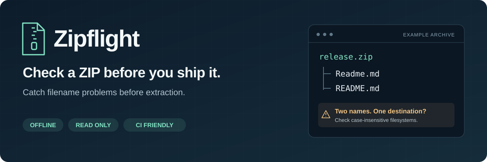

<p align="center">
  
</p>

<p align="center"><a href="README.md">English</a> · <a href="#快速试用">快速试用</a> · <a href="#检查内容">检查内容</a> · <a href="#报告和-ci">报告与 CI</a> · <a href="#同类工具">同类工具</a></p>

# Zipflight — ZIP 跨平台兼容性检查

**提前找出 ZIP 中换到 Windows、macOS 或 Linux 后，可能无法解压或互相覆盖的文件名。**

有效的 ZIP 里也可能存在 `CON.txt`、同时出现的 `Readme.md` 和 `README.md`，或者一个名为 `assets` 的文件加上 `assets/logo.png`。Zipflight 会解释这些冲突，适合在发布版本或向客户发送文件之前运行。

工具离线运行，检查压缩包元数据，输出带有处理建议的终端文本、Markdown 或 JSON 报告。**不会解压或修改压缩包。** Python 版本仅使用标准库。

## 快速试用

不需要安装 Python 包或 Git。下载对应版本后，**在下载文件所在目录打开终端**。

**有 Python 3.10+ · Windows、macOS、Linux：** 下载 [zipflight.pyz](https://github.com/zare5/zipflight/releases/download/v0.1.1/zipflight.pyz)。

```sh
python zipflight.pyz --demo
```

如果系统使用 `python3` 命令，请将示例中的 `python` 替换为 `python3`。

**Windows x64 · 没装 Python：** 下载 [zipflight-windows-x64.exe](https://github.com/zare5/zipflight/releases/download/v0.1.1/zipflight-windows-x64.exe)，在 PowerShell 运行：

```powershell
.\zipflight-windows-x64.exe --demo
```

演示会扫描一个故意包含问题的临时 ZIP，结束后自动清理，退出码 **1 是预期结果**。不会解压演示条目。Windows 可执行文件是未签名的命令行程序。

实际演示输出节选，省略了其他检查结果：

```text
Zipflight 0.1.1 | demo.zip
FAIL | 7 entries | target: portable

ERROR [windows-reserved-name] A path component is a reserved Windows device name.
  "notes/CON.txt"
  Fix: Rename the component, including names such as CON.txt or COM1.

ERROR [file-directory-conflict] This path must be both a file and a directory (possibly an implicit parent).
  "docs"
  "docs/guide.txt"
  Fix: Rename the file or the directory tree so both can exist.
```

把 `--demo` 换成 ZIP 路径，就能检查自己的文件：

```sh
python zipflight.pyz "path/to/archive.zip" --target windows
```

Windows 可执行文件接受相同参数。所有下载文件和校验和见[发布页面](https://github.com/zare5/zipflight/releases/tag/v0.1.1)。

### 安装为常用命令

如果会经常使用，可以通过 Python 3.10+ 安装已发布的 wheel，不需要 Git：

```sh
python -m pip install "https://github.com/zare5/zipflight/releases/download/v0.1.1/zipflight-0.1.1-py3-none-any.whl"
python -m zipflight archive.zip
```

安装后也可以使用 `zipflight` 命令。下文采用这个较短的写法。目前尚未发布到 PyPI。

## 检查内容

| 问题 | 压缩包条目示例 |
| --- | --- |
| Windows 保留设备名、非法字符、结尾的点或空格 | `CON.txt`、`notes:final.txt`、`report.` |
| 大小写、Unicode 与路径别名冲突 | `Readme.md` 与 `README.md`；`café.txt` 的两种 Unicode 写法 |
| 重复条目，以及文件与目录冲突 | 两个 `data.csv`；`assets` 与 `assets/logo.png` |
| 绝对路径、上级目录引用、含义不明确的分隔符 | `../outside.txt`、`/root/file`、反斜杠 |
| 文件名和目标路径长度 | 较长的解压目录加上深层文件夹 |
| 解压软件兼容性和元数据提示 | 加密、符号链接、特殊压缩方法、旧编码、系统杂项 |

还会检查控制字符、双向文本格式字符和极高的声明膨胀比例。详见[全部规则与严重程度](docs/checks.md)。

### 目标平台和路径长度

默认的 `portable` 会综合检查各平台的兼容性问题。也可以按接收方系统选择：

```sh
zipflight archive.zip --target windows
zipflight archive.zip --target macos
zipflight archive.zip --target linux
```

Windows 路径长度检查默认给解压目录预留 **40 个 UTF-16 代码单元**，不含末尾分隔符。如果接收方通常解压到较深的文件夹，可以增加估计值：

```sh
zipflight archive.zip --target windows --root-length 80
```

工具会另加一个分隔符和压缩包内的路径长度。这是针对旧版路径限制的提示；支持长路径的解压软件可能不受它影响。

## 报告和 CI

```sh
zipflight archive.zip --format markdown > zip-report.md
zipflight archive.zip --format json > zip-report.json
zipflight archive.zip --fail-on warning
```

默认只在发现错误时返回失败。加上 `--fail-on warning`，警告也会导致失败，包括较保守的大小写和 Unicode 碰撞提示。

| 退出码 | 含义 |
| --- | --- |
| `0` | 没有达到所选失败阈值的问题。 |
| `1` | 扫描完成，发现错误；或者在 `--fail-on warning` 下发现警告。 |
| `2` | 无法完成扫描，或命令参数无效。 |

因此，默认情况下标为 `WARN` 的报告仍会返回 **0**。字段说明、错误响应和输出限制见[报告格式](docs/report-format.md)。报告包含文件名，分享前请检查。

<details>
<summary>GitHub Actions：在构建 ZIP 后运行检查</summary>

在生成 `dist/release.zip` 的步骤之后加入：

```yaml
- uses: actions/setup-python@v7.1.0
  with:
    python-version: '3.12'
- run: python -m pip install "https://github.com/zare5/zipflight/releases/download/v0.1.1/zipflight-0.1.1-py3-none-any.whl"
- run: python -m zipflight dist/release.zip --target portable --fail-on warning
```

</details>

## 功能边界

**这是元数据检查，不是完整性测试，也不是安全保证。** 它不验证文件内容、CRC、本地文件头一致性、嵌套压缩包、剩余磁盘空间或实际解压结果，也不修复文件名。大小与膨胀比例来自压缩包的声明，没有经过内容验证。

大小写和 Unicode 碰撞规则是对文件系统行为的近似判断，不会完整模拟具体系统或解压软件。没有发现问题，只表示已实现的规则未触发。[已记录的边界](docs/report-format.md#bounds-and-unsupported-structures)限制了条目数量、元数据大小、路径深度和报告条数；元数据过大或结构不受支持时，扫描会停止。

## 同类工具

| 如果你需要…… | 可以考虑 |
| --- | --- |
| 同时检查文件夹、Git 路径和 ZIP 的兼容性 | [Treeport](https://github.com/rad1092/treeport)，是功能有较多重合、支持更多输入类型的直接替代方案。 |
| 预览或应用支持的 ZIP 文件名、编码修复 | [zipkirei](https://github.com/yuk7/zipkirei)。 |
| 检查压缩内容和 CRC | `unzip -t`，或压缩软件的完整性测试。 |

Zipflight 聚焦于**分享或发布本地 ZIP 前的检查报告**，实现为一个小型 Python 工具。详见[完整对比](docs/alternatives.md)和[需求调研](docs/research.md)。

## 参与改进

发现漏报或误报，可以[提交 issue](https://github.com/zare5/zipflight/issues/new/choose)，提供目标平台、问题代码和最小文件名列表。不需要上传私人压缩包。

[开发与测试](CONTRIBUTING.md) · [更新记录](CHANGELOG.md) · [MIT 许可证](LICENSE)
